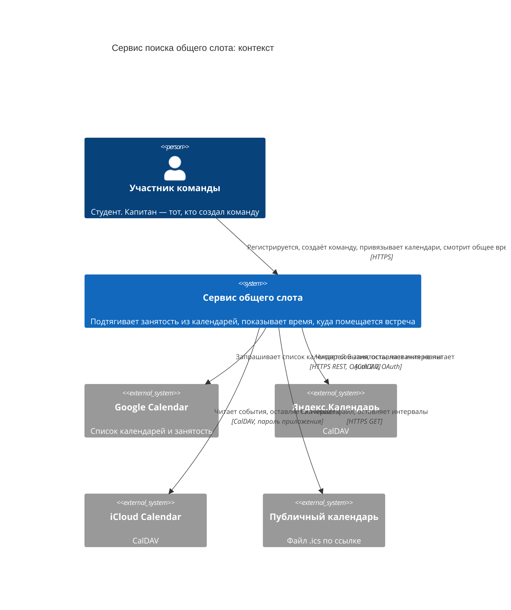
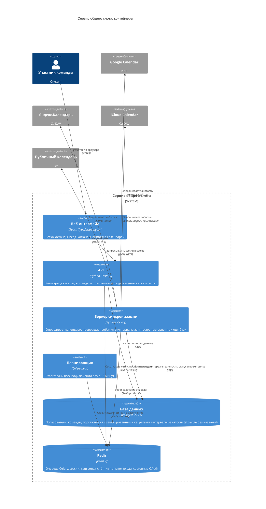

# RAT-PoC: черновик презентации (Босс 2)

Черновик, не финальный текст. Структура идёт по блоку «Что загружаем» на https://pvp-miem.ru/bosses/poc: продукт и USM → риски → решение (RAT) → сборка. Числа без пометки «ожидается» уже измерены, источники в `poc-assets/measurements.md`. Оценки вероятности и ущерба, MoSCoW и формулировки допущений — предложения, команда их утверждает.

Статус разделов: **готово черновиком** — B1–B12 (B9 — скриншоты в `poc-assets/`); **ждёт ваших решений** — критерий RAT (дата фиксации), имена ответственных в плане деградации, формат сборки слайдов.

---

## B1. Vision и mission

**Vision.** Учебная команда находит общее время для встречи за минуты, а не за дни, и не сравнивает чужие расписания глазами.

**Mission.** Сервис подтягивает занятость участников из их календарей (Google, Яндекс, Apple или публичная ссылка), хранит только интервалы «занят» без названий событий и подсвечивает время, в которое помещается встреча нужной длины.

---

## B2. User stories и User Story Map

Типы пользователей: **капитан** (создаёт команду), **участник с календарём**. Участник без календаря с ручным вводом окон уходит в прототип.

### User stories (шаблон As a … I want … so that …)

| ID | История | MoSCoW | Этап | Зависит от |
| --- | --- | --- | --- | --- |
| US1 | As a капитан, I want создать команду и отправить участникам ссылку-приглашение, so that не собирать расписания вручную | Must | PoC, сделано | — |
| US2 | As a участник, I want привязать свой календарь (Google, Яндекс, Apple или публичную ссылку), so that моя занятость подтягивалась сама | Must | PoC, сделано | — |
| US3 | As a участник, I want выбирать, какие календари учитывать, и чтобы названия событий не сохранялись, so that контролировать приватность | Must | PoC, сделано | US2 |
| US4 | As a капитан, I want видеть на сетке время, куда помещается встреча нужной длины, и менять длину и детализацию, so that не сравнивать сетки глазами | Must | PoC, сделано | US1, US2 |
| US5 | As a участник, I want видеть, насколько свежи данные каждого участника, so that доверять предложенному времени | Should | PoC, сделано | US2 |
| US6 | As a капитан, I want зафиксировать выбранный слот, so that у всех было одно время | Should | Прототип | US4 |
| US7 | As a участник без календаря, I want отметить свободные окна вручную, so that тоже участвовать в подборе | Should | Прототип | US1 |
| US8 | As a капитан, I want пинговать не ответивших поимённо, so that не ждать всех в общем чате | Could | MVP | US6 |
| US9 | As a участник, I want чтобы после переноса пары общее время пересчитывалось само, so that не начинать согласование заново | Must | PoC (опрос раз в 15 мин), доработка в MVP | US2 |
| US10 | As a команда, I want видеть историю встреч и повторять слоты, so that назначать регулярные встречи быстрее | Won't сейчас | MUP | US6 |

INVEST: каждая история отдельно проверяема на образце (US4 — тестом на 10 000 расписаний, US3 — проверкой дампа базы). US10 исключена из MVP, потому что в опросе получила 3,72 против 4,22 у автоматического пересчёта.

### User Story Map

Слева направо порядок активностей капитана и участника, сверху вниз — этапы релизов (контрольные точки курса из слайда 11 Босса 1).

| | Создать команду | Подключить календарь | Увидеть общее время | Договориться | Поддерживать актуальность |
| --- | --- | --- | --- | --- | --- |
| **PoC, 17 октября** | US1 создать команду и ссылку-приглашение | US2 привязать аккаунт или ссылку, US3 выбрать календари и busy-only | US4 сетка и слоты по наведению | — | US5 свежесть данных, US9 опрос раз в 15 мин |
| **Прототип, 5 декабря** | — | US7 ручной ввод окон | — | US6 фиксация слота | — |
| **MVP, 23 января** | — | все 4 провайдера, режим «только занятость» | кворум (слот, где свободно большинство) | US8 напоминание не ответившим, бот | автоперсчёт после изменения расписания, ETag-синк |
| **MUP, 13 марта** | внедрение в 5 командах вне группы | — | — | US10 история встреч | метрики в продукте |

Зависимости: US6 нельзя без US4, US4 нельзя без US2, US8 нельзя без US6.

---

## B3. Риски

Главные пять рисков в форме «если — то», по группам. Вероятность и ущерб — по трёхбалльной шкале (1 низкая, 3 высокая).

| ID | Группа | Если … | То … | Вер. | Ущерб | Стратегия | Метод или технология | Проверка и число | Статус |
| --- | --- | --- | --- | --- | --- | --- | --- | --- | --- |
| R1 | Технический, надёжность | алгоритм слотов пропустит допустимое время или предложит занятое | команда сорвёт встречу и перестанет доверять сервису | 2 | 3 | Снижаем | Одна функция `overlay` в `backend/app/domain/__init__.py`, сверка с поминутным эталоном через property-тест (hypothesis) | 10 000 случайных расписаний, 0 расхождений, граничные случаи отдельными тестами | **проверено** |
| R2 | Технический, безопасность | токены, пароли приложений или названия событий утекут из базы | нарушим обещание приватности, 8 из 18 опрошенных иначе не подключили бы календарь | 1 | 3 | Снижаем и избегаем (названия не храним вообще) | Таблица `busy_intervals` без полей с названиями, секреты подключений шифруются AES-GCM, пароли пользователей хешируются scrypt | `pg_dump` и grep по 28 секретам и названиям реальных событий: 0 совпадений; пароли 6 из 6 в формате scrypt | **проверено** |
| R3 | Технический, производительность | сетку командной недели считать на каждый запрос без кеша | в пиковый вечер время ответа превысит порог, пользователи уйдут | 2 | 2 | Снижаем | Кеш Redis с версионным ключом (ключ меняется при синке и выборе календарей) и ETag с ответом 304 | Порог p95 < 100 мс. Замер k6: при 5 и 15 запросах/с p95 44 и 35 мс с кешем (56 и 48 мс без кеша); при 30 запросах/с с кешем 135 мс, без кеша 994 мс; при 60 запросах/с одного процесса не хватает (исчерпан пул соединений БД). Ожидаемый пик ≈ 1,3 запроса/с | **проверено** на ожидаемом пике, предел одного процесса измерен |
| R4 | Архитектурный | опрос календарей идёт внутри запроса пользователя, а внешний сервер медленный или недоступен | запросы упадут по таймауту, а при долгом сбое слот будет предложен по устаревшим данным | 2 | 2 | Снижаем | Синк вынесен в воркер Celery, планировщик beat раз в 15 минут и при старте воркера, повторы с экспоненциальной паузой 30→60→120→240 с, статус подключения и пометка «обновлено N мин назад» | Время синка (14 дней, 1 календарь): ссылка 0,06 с, Яндекс 0,14 с, Google 0,28 с, Apple 0,48 с (медианы), максимум 1,53 с при пороге 10 с; тесты повторов | **проверено** |
| R5 | Бизнес | у студентов пары не лежат в привязываемом календаре (HSE App X) или они не дойдут до конца привязки | продукт деградирует до When2Meet | 3 | 3 | Принимаем в PoC, проверяем в прототипе | Публичная ссылка на календарь как запасной путь с минимальным трением; тип подключения фиксируется для будущей воронки | В PoC **не проверялось** (опрос студентов исключён решением команды). Цель на прототип: не менее 60% доходят до конца привязки | осознанно отложено |

Дополнительные риски из полного реестра, не вошедшие в главные пять: «у команды нет общего свободного окна» (принимаем, кворум в MVP), масштабирование синка (3 200 синков за 15 минут ≈ 3,6 в секунду, один воркер справляется, B4 уточнит).

### Матрица «вероятность × ущерб»

| Вероятность \ Ущерб | 1 низкий | 2 средний | 3 высокий |
| --- | --- | --- | --- |
| **3 высокая** | | | **R5** |
| **2 средняя** | | **R3, R4** | **R1** |
| **1 низкая** | | | **R2** |

Порядок проверки, привязанный к срокам: R1 и R2 — сделано до 17 октября (измерения 15 октября), R4 — сделано, R3 — замер нагрузки сделан 15 октября, R5 — прототип, 5 декабря.

---

## B4. Прикидка нагрузки главного сценария на пик

Главный сценарий: участник подключает календарь, воркер синкает его, команда открывает сетку. Нагрузка складывается из двух потоков: фоновый синк и просмотр сетки.

| Шаг расчёта | Значение | Откуда |
| --- | --- | --- |
| Студентов и аспирантов в МИЭМ | 3 218 | miem.hse.ru/figures, слайд 4 Босса 1 |
| Из них в командах от 3 человек | около 1 600 | консервативно половина, допущение Босса 1 |
| Команд по 3–4 человека | около 450 | 1 600 / 3,5 |
| Календарей на человека | 2 | допущение; в нашем образце 1, реальный Apple-аккаунт показал 19 найденных, из них выбирают 1–3 |
| Интервал опроса | 15 минут | выбор команды (CalDAV без push, пары меняются редко) |
| **Синков в секунду** | **≈ 3,6** | 1 600 × 2 / 900 с |
| Время одного синка | 0,06–0,48 с (медиана), максимум 1,53 с | замер 15.10, таблица `poc-assets/measurements.md` |
| **Загрузка воркеров** | ≈ 3,6 × 0,3 с ≈ 1,1 процесса-секунды в секунду; воркер запущен на 8 процессах, загрузка около 14% | расчёт по замерам |
| Открытий сетки на пик | 10% людей за час × 3 запроса = 480 запросов в час | допущение команды |
| **Запросов сетки в секунду** | **≈ 0,13 в среднем, ≈ 1,3 при десятикратном всплеске** | расчёт |

Какой ресурс упрётся первым:

1. **Пул соединений API** (5 постоянных + 10 временных к Postgres). При 60 запросах/с одного процесса пул исчерпывается и в режиме с кешем (при попадании в кеш всё равно два запроса к БД: пользователь по сессии и состав команды). Это выше расчётного пика в 40–50 раз.
2. **Внешние серверы календарей.** При росте аудитории в 20 раз (все факультеты ВШЭ) синков станет около 72 в секунду, и первыми начнут ограничивать частоту сами провайдеры. Лечение в архитектуре: интервал опроса, `ctag` и sync-token (не используются, полный запрос окна каждый раз).
3. Воркеры: при тех же 20-кратных цифрах загрузка около 22 процесс-секунд в секунду, потребуется несколько воркеров. Процессы масштабируются горизонтально без изменений кода.

---

## B5. Критический путь по C4

Критический путь: **зарегистрироваться → создать команду → привязать календарь → первый синк → открыть сетку → увидеть слот**. Шаги привязаны к контейнерам диаграммы C4 L2.

| Шаг | Контейнеры | Ресурс | Бюджет задержки | Замер |
| --- | --- | --- | --- | --- |
| 1. Регистрация и вход | Веб, API, Redis, Postgres | CPU (хеш scrypt), запись пользователя, сессия в Redis | 500 мс | не снимался отдельно |
| 2. Создать команду, получить ссылку | Веб, API, Postgres | запись в БД | 200 мс | не снимался отдельно |
| 3. Привязать календарь (OAuth или пароль приложения, поиск календарей) | Веб, API, внешний календарь | сеть к провайдеру | 5 с | не снимался отдельно; поиск у Apple находит около 19 календарей |
| 4. Первый синк | Воркер, внешний календарь, Postgres | сеть к провайдеру, разбор `.ics` | 10 с | 0,06–0,48 с медиана, максимум 1,53 с |
| 5. Открыть сетку команды | Веб, API, Redis (кеш), Postgres | БД и расчёт пересечения | p95 100 мс | при ожидаемой нагрузке p95 35–56 мс |
| 6. Слот по наведению | Веб (браузер) | CPU браузера, чистая функция над клетками | 16 мс (один кадр) | не снимался |

Итоговый бюджет от нажатия «Подключить» до увидевшей сетки: около 15 секунд. Фактически основная часть уходит на шаг 3 (участие пользователя и провайдера), собственная часть (шаги 4–6) укладывается в 2 секунды. Слабое звено цепочки по надёжности — шаг 3, он зависит от провайдера и от того, что пользователь дошёл до конца (риск R5).

---

## B6. Выбор архитектуры и ADR

**Стиль: модульный монолит.** Одна кодовая база, три процесса запуска (API, воркер, планировщик), одна БД. Требование, которое это оправдывает: в команде 3 человека и одна доменная модель (пользователь, команда, подключение, интервал занятости), при этом синк нельзя делать в запросе пользователя (R4), поэтому нужен отдельный процесс.

### ADR-1. Модульный монолит вместо микросервисов

- **Контекст.** Нужно изолировать медленную сетевую работу с календарями от ответа пользователю.
- **Решение.** Один код, два режима запуска: `uvicorn` для API и `celery` для воркера и планировщика.
- **Отвергнуто.** Отдельный сервис синхронизации с собственной БД: лишняя синхронизация состояния, нет выигрыша при нагрузке 3,6 синка/с.
- **Последствия.** Масштабируем воркер отдельно, API отдельно; общая БД остаётся точкой отказа. Выделение сервиса возможно позже по границе `app/sync`.

### ADR-2. Три способа подключения: аккаунт провайдера, REST Google, публичная ссылка

- **Контекст.** Расписание живёт в Google, Яндексе, Apple, часть студентов может дать только ссылку.
- **Решение.** Привязка аккаунта: Google по OAuth и REST `freeBusy` (запрашиваются только занятые интервалы), Яндекс по OAuth и CalDAV, Apple по паролю приложения и CalDAV. Публичная ссылка на `.ics` — вторичный путь.
- **Отвергнуто.** Только ссылки на `.ics`: нет выбора календарей, названия приходят в файле, полный файл каждый раз. Только Google API: закрывает один провайдер. CalDAV Google: требует OAuth и проверки приложения.
- **Последствия.** Один порт для разных адаптеров (`app/adapters`). Для Google названия событий не запрашиваются вообще. Яндекс принимает `Authorization: OAuth` для CalDAV — проверено на реальном аккаунте.

### ADR-3. Храним только интервалы занятости, секреты шифруем

- **Контекст.** 8 из 18 опрошенных дадут календарь только без личных событий.
- **Решение.** В базу попадают начало, конец и идентификатор вхождения; поля названия нет в схеме. Секреты подключений шифруются AES-GCM, пароли пользователей хешируются scrypt.
- **Отвергнуто.** Хранить события целиком и скрывать названия на уровне интерфейса: утечка базы раскрыла бы названия. Менеджер секретов (vault): избыточно для PoC, ключ лежит в переменной окружения.
- **Последствия.** Проверяется командой `pg_dump` и grep (0 совпадений из 28). Смена ключа без миграции сделает подключения нечитаемыми.

### Слайд «альтернативный путь» (оценка 10)

| | Привязка аккаунта (наш основной) | Публичная ссылка на `.ics` (запасной) |
| --- | --- | --- |
| Что делает пользователь | OAuth или пароль приложения, выбор календарей | вставляет ссылку |
| Выбор календарей | да (у реального Apple-аккаунта найдено 19) | нет, один файл на ссылку |
| Названия событий | не сохраняются, у Google не запрашиваются | приходят в файле, отбрасываются при разборе |
| Время синка, медиана | Яндекс 0,14 с, Google 0,28 с, Apple 0,48 с | 0,06 с |
| Инкрементальность | нет, окно запрашивается целиком (`ctag` не используется) | нет, файл целиком |
| Когда ломается | токен отозван → статус `auth_failed`, нужно пройти привязку заново | ссылка закрыта → «ссылка недоступна» |
| Вывод | основной путь, потому что даёт выбор календарей и права доступа без секретной ссылки | запасной для тех, кто не хочет давать аккаунт |

Отдельное сравнение внутри Google: REST `freeBusy` вместо CalDAV. REST возвращает сразу занятые интервалы без названий (меньше данных, одно обращение), CalDAV Google требует OAuth и проверки приложения до января.

---

## B7. Рискованное допущение (RAT)

**Считаем.** Привязка аккаунта (Google и Яндекс по OAuth, Apple по паролю приложения) и импорт по публичной ссылке дают интервалы занятости без названий событий, включая реальные расписания с повторами и часовыми поясами, и из них корректно и полно строятся допустимые слоты команды.

**Критерий успеха, записан до итогового прогона.** Пороги зафиксированы в плане работ от 15 октября (до измерений): подключены все четыре типа источников; 100% кейсов разбора `.ics`; 0 расхождений алгоритма с поминутным эталоном на не менее 10 000 расписаний; 0 паролей, токенов и названий событий в выгрузке базы; синк одного календаря не дольше 10 с; p95 запроса сетки меньше 100 мс. *Дату и время фиксации критерия укажите сами; если нужна опора для проверяющего, закоммитьте этот файл раньше итоговой правки.*

**Проверили так и получилось.**

| Критерий | Как проверяли | Результат |
| --- | --- | --- |
| Все четыре источника подключаются | реальные аккаунты Google, Яндекс, Apple и публичная ссылка в одной команде из четырёх человек | **4 из 4**, подключения в статусе `active`, автосинк работает |
| Разбор `.ics` | 10 тестов: повторы, исключения (EXDATE), перенесённый экземпляр, часовые пояса, событие через полночь, начавшееся до окна, события без блокировки и отменённые, весь день | **10 из 10** |
| Алгоритм слотов | property-тест против поминутного эталона (hypothesis) | **10 000 расписаний, 0 расхождений** (корректность и полнота) |
| Приватность в базе | `pg_dump`, поиск 28 шаблонов (токены, пароль приложения, URL, названия и места 83 реальных событий) | **0 совпадений**; пароли пользователей 6 из 6 хеши scrypt; секреты подключений в зашифрованном виде |
| Время синка | 5 запусков каждого типа, окно 14 дней | максимум **1,53 с** при пороге 10 с |
| Скорость сетки | k6, 450 команд, 201 804 интервала | **p95 35–56 мс при 5–15 запросах/с** (ожидаемый пик 1,3), 135 мс при 30 запросах/с с кешем |
| Яндекс принимает OAuth для CalDAV | реальный аккаунт | **да**, подключение и синк работают |

**Чего не получилось и что не проверено.**

- Поведенческая часть допущения (доходят ли студенты до конца привязки, лежат ли пары в календаре) в PoC не проверялась по решению команды; это бизнес-риск R5, цель на прототип 60%.
- Один процесс API держит до 15–30 запросов/с; при 60 запросах/с исчерпывается пул соединений БД (в обоих режимах). Для ожидаемого пика это запас в десятки раз, но предел виден.
- Google подключён не через CalDAV, а через REST `freeBusy` (ADR-2).

---

## B8. Диаграммы C4

Диаграммы в синтаксисе Mermaid C4, рендерятся на mermaid.live. Для слайдов их можно экспортировать картинкой или перерисовать в редакторе.

### Уровень 1: контекст

### Уровень 2: контейнеры

Примечания к диаграммам. Веб, API, воркер и планировщик собираются из одной кодовой базы (модульный монолит). Redis относится к инфраструктуре бэкенда, а не к отдельному продукту, поэтому вынесен внутрь границы системы. Название события не покидает воркер: в базу попадают только начало, конец и идентификатор вхождения.

---

## B9. Макеты и скриншоты реального интерфейса

Снято на образце 15 октября, пользователь `vdmatsnev@google.com`, команда из четырёх участников.

| Файл | Что показывает |
| --- | --- |
| `poc-assets/01-grid-team.jpg` | Сетка команды: красный оттенок — доля занятых, бледно-зелёный — клетки, куда встанет слот |
| `poc-assets/02-slot-hover.jpg` | Наведение на клетку: тёмно-зелёный слот нужной длины, подсказка «Слот 10:00–11:00, Свободны: 4/4», подпись под сеткой |
| `poc-assets/03-invite-link.jpg` | Панель команды со ссылкой-приглашением, статусы «обновлено N мин назад» у каждого участника |
| `poc-assets/04-connect-tiles.jpg` | Экран привязки: Google, Яндекс, Apple, ссылка на календарь |
| `poc-assets/05-grid-only-me.jpg` | Режим «Только я»: сетка одного пользователя (красный — занято), в панели один участник |
| `poc-assets/06-connect-link.jpg` | Привязка по публичной ссылке: поле для `https://` или `webcal://` |
| `poc-assets/07-connect-apple.jpg` | Привязка Apple: email Apple ID и пароль приложения |

Что поправить до сдачи: на скриншотах `01`–`03` справа виден адрес `sampleuser028@gmail.com` в разделе «Мои календари». Если нужно скрыть, замазать или переснять. Три вайрфрейма из слайдов Босса 1 остаются как макеты; время слота на первом и втором вайрфрейме надо свести к одному значению (замечание из списка «Что доделать» Босса 1).

---

## B10. План деградации и CAP

### План деградации

| Триггер | Что упрощаем или отключаем | Ответственный | Как возвращаем |
| --- | --- | --- | --- |
| p95 запроса сетки > 500 мс на 5 минут | кеш уже включён; увеличиваем число процессов API и размер пула соединений (настройка, перезапуск); при необходимости увеличиваем шаг сетки по умолчанию, чтобы ячеек было меньше | *(имя)* | p95 < 200 мс 10 минут подряд |
| Ошибок синка у провайдера > 20% за интервал опроса | автоповторы с паузами 30, 60, 120, 240 с уже работают; пользователь видит последние данные с пометкой «обновлено N мин назад» и может нажать «Обновить» | *(имя)* | ошибок < 5% |
| Токен или пароль приложения отозван | статус `auth_failed`, подключение исключается из сетки до повторной привязки | пользователь | пользователь проходит привязку заново |
| Redis недоступен | **сервис фактически недоступен для входа**: в Redis лежат сессии, очередь, кеш; кеш сам переживает сбой, вход и очередь нет | *(имя)* | перезапустить контейнер; в плане на прототип — вынести сессии в Postgres |
| Postgres недоступен | сервис недоступен целиком | *(имя)* | восстановить базу, данные синка восстановятся при следующем опросе |

Следующий шаг (прототип): circuit breaker (после трёх подряд сбоев подключение не опрашивается 15 минут), сессии в Postgres.

### CAP по операциям

| Операция | Выбор | Что видит пользователь |
| --- | --- | --- |
| Состав команды, регистрация, подключения | согласованность (CP) через Postgres | при недоступной базе операция не выполняется |
| Чтение сетки | данные последнего синка, eventual consistency | сетка по последним данным с пометкой «обновлено N мин назад» |
| Синк календарей | доступность и eventual consistency (AP) | изменения в календаре появляются с задержкой до 15 минут |

---

## B11. План развития и матрица трассируемости

### План развития архитектуры

| Этап | Что меняется в архитектуре |
| --- | --- |
| PoC, 17 октября | модульный монолит: API, воркер, планировщик, Redis, Postgres; кеш сетки, опрос раз в 15 минут |
| Прототип, 5 декабря | фиксация слота с ограничением исключения в Postgres (две параллельные фиксации пересекающегося времени: проходит одна), ручной ввод окон, circuit breaker, сессии в Postgres |
| MVP, 23 января | кворум (слот, где свободно большинство), бот на long polling, `ctag` и sync-token вместо полного окна, автоперсчёт после изменения, линтеры в CI |
| MUP, 13 марта | внедрение в 5 командах вне группы, метрики в продукте |

### Матрица трассируемости

| История | Риск | Работа и решение | Контейнер C4 | Метрика и результат |
| --- | --- | --- | --- | --- |
| US1 команда и приглашение | — | модели команды и участника, ссылка-приглашение | Веб, API, Postgres | приглашение проходит сквозным тестом |
| US2, US3 привязка и приватность | R2, R5 | адаптеры Google, Яндекс, Apple, ссылка; busy-only; AES-GCM | API, воркер, внешние календари | 4 из 4 источников подключены; 0 из 28 шаблонов в дампе |
| US4 слот на сетке | R1, R3 | алгоритм `overlay`, кеш с ETag | API, Redis, Postgres | 0 расхождений на 10 000 расписаний; p95 35–56 мс при ожидаемом пике |
| US5, US9 свежесть и автоперсчёт | R4 | воркер, beat, повторы с паузой | Воркер, Redis, Postgres | максимум 1,53 с на синк при пороге 10 с; задержка до 15 минут |
| US6 фиксация слота | R1 | ограничение исключения в Postgres | API, Postgres | прототип: 0 двойных фиксаций |
| US7 ручной ввод окон | R5 | ввод окон без календаря | Веб, API | прототип |

---

## B12. Расхождения старых слайдов с кодом (исправить при сборке)

| Было в слайдах Босса 1 | Как в коде | Что писать |
| --- | --- | --- |
| Яндекс подключается паролем приложения | Яндекс подключается по OAuth, CalDAV принимает заголовок OAuth | OAuth, проверено на реальном аккаунте |
| Шифрование Fernet, секреты в vault | AES-GCM, ключ из переменной окружения; пароли пользователей — scrypt | AES-GCM, ключ из окружения; vault — на потом |
| Google через CalDAV после экспорта пар | Google через REST `freeBusy` (OAuth) | REST freeBusy, названия не запрашиваются |
| Ссылка на `.ics` — отвергнутый вариант | есть как запасной путь | вторичный путь, основной — привязка аккаунта |
| Сессии не упоминались | сессии в Redis, вход по email и паролю | добавить в C4 L2 и в план деградации (Redis — точка отказа) |

Что не вошло в PoC и честно говорится на слайде: фиксация слота, ручной ввод окон, circuit breaker, опрос студентов (поведенческая часть допущения), `free-busy-query` в CalDAV.
